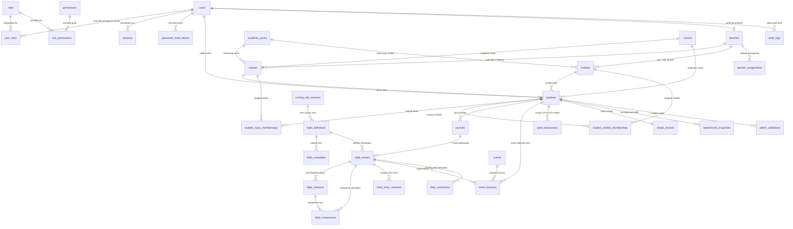

# ENTITY RELATIONSHIP DIAGRAM (ERD) & KAMUS DATA LENGKAP — VERTIKAL SMA JAWARA 28

Dokumen ini memenuhi **Deliverable 2, 4, dan 5** dari Master Prompt Reengineering Database & Backend.

---

## 1. Diagram Relasi Entitas (ERD — 35 Tabel Relasional)

---

## 2. Kamus Data (Data Dictionary) — 35 Tabel Relasional

Seluruh tabel didefinisikan secara eksplisit di [`001_initial_postgresql_schema.sql`](../server/src/database/migrations/001_initial_postgresql_schema.sql) dan [`client.ts`](../server/src/database/client.ts).

### Domain A: Autentikasi, Pengguna, Sesi & RBAC (7 Tabel)

| Nama Tabel | Primary Key | Foreign Key & On Delete | Constraint Unik & Check | Fungsi & Kolom Utama |
| :--- | :--- | :--- | :--- | :--- |
| **`users`** | `id` (`VARCHAR(64)`) | - | `UNIQUE(username)`, `UNIQUE(email)`, `CHECK(account_status IN ('ACTIVE','INACTIVE','SUSPENDED','ARCHIVED'))` | Tabel induk akun login: `username`, `password_hash` (`scrypt$N$r$p$salt$hash`), `password_algo`, `full_name`, `account_status`, `failed_login_attempts`, `last_login_at`. |
| **`roles`** | `id` (`VARCHAR(64)`) | - | `UNIQUE(code)`, `CHECK(code IN ('SISWA','GURU_WALAS','GURU_WALI','TIM_7_KAIH','SUPER_ADMIN'))` | Master peran pengguna (`code`, `name`, `description`). |
| **`permissions`** | `id` (`VARCHAR(64)`) | - | `UNIQUE(code)` | Master izin granular (`code` misal `journal:write:self`, `module`, `description`). |
| **`role_permissions`** | `(role_id, permission_id)` | `role_id -> roles(id) CASCADE`, `permission_id -> permissions(id) CASCADE` | PK Komposit | Pemetaan many-to-many antara `roles` dan `permissions`. |
| **`user_roles`** | `id` (`VARCHAR(64)`) | `user_id -> users(id) CASCADE`, `role_id -> roles(id) RESTRICT` | `UNIQUE(user_id, role_id, scope_type, scope_id)` | Penugasan peran beserta batasan cakupan (`scope_type`: `SELF`, `CLASS`, `ROMBEL`, `SCHOOL`, `GLOBAL`; `scope_id`: nama kelas/rombel/ID siswa). |
| **`sessions`** | `id` (`VARCHAR(64)`) | `user_id -> users(id) CASCADE` | `UNIQUE(token_hash)` | Sesi login aktif di DB: menyimpan `token_hash` (SHA-256 dari Bearer token), `active_role`, `expires_at`, `revoked_at`, `revoked_reason`. |
| **`password_reset_tokens`** | `id` (`VARCHAR(64)`) | `user_id -> users(id) CASCADE` | `UNIQUE(token_hash)` | Token reset password satu kali pakai dengan `expires_at` dan `used_at`. |

---

### Domain B: Struktur Akademik, Profil Siswa, Guru & Riwayat Keanggotaan (9 Tabel)

| Nama Tabel | Primary Key | Foreign Key & On Delete | Constraint Unik & Check | Fungsi & Kolom Utama |
| :--- | :--- | :--- | :--- | :--- |
| **`academic_years`** | `id` (`VARCHAR(64)`) | - | `UNIQUE(name)`, `CHECK(semester IN ('GANJIL','GENAP'))` | Tahun ajaran & semester aktif (`2026/2027`, `start_date`, `end_date`, `is_active`). |
| **`cohorts`** | `id` (`VARCHAR(64)`) | - | `UNIQUE(name)`, `CHECK(grade_level IN ('X','XI','XII','ALUMNI'))` | Data angkatan siswa (`entry_year`, `grade_level`). |
| **`teachers`** | `id` (`VARCHAR(64)`) | `user_id -> users(id) RESTRICT` | `UNIQUE(user_id)`, `UNIQUE(nip)`, `CHECK(assignment_type IN ('WALAS','GURU_WALI','BOTH','TIM_7_KAIH','ADMIN'))` | Profil pendidik & admin: `nip`, `name`, `role_title`, `assignment_type`, `class_name`, `rombel_name`, `account_status`. |
| **`classes`** | `id` (`VARCHAR(64)`) | `cohort_id -> cohorts(id)`, `academic_year_id -> academic_years(id)`, `walas_teacher_id -> teachers(id)` | `UNIQUE(name)`, `CHECK(grade_level IN ('X','XI','XII'))` | Master kelas formal (`XI-MIPA-1`, `walas_teacher_id`, `walas_name`, `capacity`). |
| **`rombels`** | `id` (`VARCHAR(64)`) | `academic_year_id -> academic_years(id)`, `wali_teacher_id -> teachers(id)` | `UNIQUE(name)` | Master kelompok binaan lintas kelas (`Rombel Sains & Riset A`, `wali_teacher_id`, `wali_name`). |
| **`students`** | `id` (`VARCHAR(64)`) | `user_id -> users(id) RESTRICT`, `cohort_id -> cohorts(id)`, `class_id -> classes(id)`, `rombel_id -> rombels(id)` | `UNIQUE(user_id)`, `UNIQUE(nisn)`, `UNIQUE(nis)`, `CHECK(religion IN ('Islam','Kristen','Katolik','Hindu','Buddha','Konghucu'))` | Profil siswa: `nisn`, `name`, `gender`, `religion`, `class_name`, `rombel_name`, `xp`, `poin_hebat`, `level`, `streak`, `best_streak`, `predicate`, `walas_notes`, `walas_recommendation`, `account_status`. |
| **`student_class_memberships`** | `id` (`VARCHAR(64)`) | `student_id -> students(id) CASCADE`, `class_id -> classes(id) RESTRICT`, `academic_year_id -> academic_years(id)` | `CHECK(is_current IN (0,1))` | Riwayat keanggotaan kelas siswa (`start_date`, `end_date`, `is_current`, `move_reason`) agar mutasi kelas tidak menghapus histori. |
| **`student_rombel_memberships`** | `id` (`VARCHAR(64)`) | `student_id -> students(id) CASCADE`, `rombel_id -> rombels(id) RESTRICT`, `academic_year_id -> academic_years(id)` | `CHECK(is_current IN (0,1))` | Riwayat keanggotaan rombel binaan siswa (`start_date`, `end_date`, `is_current`, `move_reason`). |
| **`teacher_assignments`** | `id` (`VARCHAR(64)`) | `teacher_id -> teachers(id) CASCADE`, `class_id -> classes(id)`, `rombel_id -> rombels(id)` | `CHECK(assignment_role IN ('GURU_WALAS','GURU_WALI','TIM_7_KAIH','SUPER_ADMIN'))` | Penugasan formal guru terhadap kelas atau rombel per tahun ajaran. |

---

### Domain C: 7 Kebiasaan Anak Indonesia Hebat & Jurnal Harian (8 Tabel)

| Nama Tabel | Primary Key | Foreign Key & On Delete | Constraint Unik & Check | Fungsi & Kolom Utama |
| :--- | :--- | :--- | :--- | :--- |
| **`scoring_rule_versions`** | `id` (`VARCHAR(64)`) | - | `UNIQUE(version_code)` | Versi aturan penilaian (`7KAIH-FINAL-2026.1`, `no_missed_penalty=1`, `bonus_cap_score=100.0`). |
| **`habit_definitions`** | `id` (`VARCHAR(64)`) | `scoring_version_id -> scoring_rule_versions(id)` | `UNIQUE(code)`, `UNIQUE(order_no)` | Katalog 7 kebiasaan (`bangun`, `ibadah`, `olahraga`, `makan`, `belajar`, `masyarakat`, `tidur`), `multi_session`, `form_schema_json`. |
| **`habit_schedules`** | `id` (`VARCHAR(64)`) | `habit_code -> habit_definitions(code) CASCADE` | `UNIQUE(habit_code, session_code)` | Rentang jadwal waktu sesi (`subuh`, `zuhur`, `asar`, `magrib`, `isya`, `pagi`, `siang`, `malam`). |
| **`journals`** | `id` (`VARCHAR(64)`) | `student_id -> students(id) CASCADE`, `class_id_snapshot -> classes(id)`, `rombel_id_snapshot -> rombels(id)` | `UNIQUE(student_id, journal_date)`, `CHECK(daily_average_score BETWEEN 0 AND 100)` | Header jurnal harian per siswa per tanggal: `completed_habits_count` (`0..7`), `daily_average_score`, `journal_status` (`BELUM_DIMULAI`, `SEDANG_DIISI`, `SELESAI`, `BELUM_DIISI_TERLEWAT`), `is_locked`. |
| **`habit_entries`** | `id` (`SERIAL` / `INTEGER`) | `journal_id -> journals(id) CASCADE`, `student_id -> students(id) CASCADE`, `habit_code -> habit_definitions(code)` | `UNIQUE(entry_uuid)`, `UNIQUE(student_id, log_date, habit_code, sub_category)`, `CHECK(final_score BETWEEN 0 AND 100)` | Entri kartu kebiasaan: `card_status`, `entry_mode` (`TEPAT_HARI`, `TEPAT_HARI_FLEKSIBEL`, `TEPAT_HARI_TIMESTAMP`, `FORMULIR_TERLEWAT`), `base_score`, `bonus_score`, `final_score`, `overflow_bonus_points`, `is_locked`, `description_text`, `payload_json`. |
| **`habit_sessions`** | `id` (`VARCHAR(64)`) | `habit_entry_id -> habit_entries(id) CASCADE`, `student_id -> students(id) CASCADE` | `UNIQUE(student_id, log_date, habit_code, session_code)` | Penyimpanan sesi multi-waktu (`subuh..isya`, `halangan`, `pagi..malam`): `session_status`, `execution_time`, `raw_session_score`, `normalized_session_score`. |
| **`habit_components`** | `id` (`VARCHAR(64)`) | `habit_entry_id -> habit_entries(id) CASCADE`, `habit_session_id -> habit_sessions(id) CASCADE` | - | Rincian indikator nilai per kebiasaan (`waktu_bangun`, `kerapian_tempat_tidur`, `kebugaran`, `karbohidrat`, `protein`, dll.) beserta `score_earned` dan `max_possible_score`. |
| **`habit_entry_revisions`** | `id` (`VARCHAR(64)`) | `habit_entry_id -> habit_entries(id) CASCADE`, `changed_by -> users(id)` | `UNIQUE(habit_entry_id, revision_no)` | Riwayat revisi nilai (`previous_final_score`, `new_final_score`, `change_source`, `reason`). |

---

### Domain D: Poin, Streak, Event Bonus & Leaderboard (5 Tabel)

| Nama Tabel | Primary Key | Foreign Key & On Delete | Constraint Unik & Check | Fungsi & Kolom Utama |
| :--- | :--- | :--- | :--- | :--- |
| **`events`** | `id` (`VARCHAR(64)`) | `created_by -> users(id)` | `UNIQUE(code)` | Master event gamifikasi (`AKTIVITAS_SERU_HARIAN`, `bonus_score_amount=10.0`, `min_story_chars=15`). |
| **`event_bonuses`** | `id` (`SERIAL` / `INTEGER`) | `event_id -> events(id)`, `student_id -> students(id) CASCADE`, `habit_entry_id -> habit_entries(id)` | `UNIQUE(student_id, log_date)`, `CHECK(length(story) >= 15)` | Cerita Aktivitas Seru harian: mencatat `bonus_awarded` (`10`), `applied_to_habit_score` (sampai batas `100`), dan `overflow_to_poin_hebat` (kelebihan di atas `100`). |
| **`point_transactions`** | `id` (`VARCHAR(64)`) | `student_id -> students(id) CASCADE` | `UNIQUE(student_id, point_bucket, source_type, source_id)` | Buku besar mutasi poin (`XP`, `POIN_HEBAT`, `STREAK_BONUS`) yang idempoten dan anti-duplikasi. |
| **`streak_records`** | `id` (`VARCHAR(64)`) | `student_id -> students(id) CASCADE` | `UNIQUE(student_id)` | Menyimpan `current_streak`, `longest_streak`, `total_complete_days`, `total_active_days`, `last_completed_date`, `streak_status`. |
| **`leaderboard_snapshots`** | `id` (`VARCHAR(64)`) | `student_id -> students(id) CASCADE` | `UNIQUE(period_type, period_key, scope_type, scope_id, student_id)` | Snapshot peringkat siswa berdasarkan periode (`DAILY`, `WEEKLY`, `MONTHLY`, `SEMESTER`, `ALL_TIME`) dan scope (`SCHOOL`, `CLASS`, `ROMBEL`, `COHORT`). |

---

### Domain E: Administrasi, Validasi, Koreksi Data & Audit Trail (6 Tabel)

| Nama Tabel | Primary Key | Foreign Key & On Delete | Constraint Unik & Check | Fungsi & Kolom Utama |
| :--- | :--- | :--- | :--- | :--- |
| **`admin_validations`** | `id` (`SERIAL` / `INTEGER`) | `student_id -> students(id) CASCADE`, `verified_by_user_id -> users(id)` | `CHECK(verification_score BETWEEN 1 AND 5)` | Skor verifikasi kualitas rapor oleh Tim 7 KAIH / Admin (`1..5` bintang) beserta `notes`. |
| **`data_corrections`** | `id` (`SERIAL` / `INTEGER`) | `habit_entry_id -> habit_entries(id)`, `student_id -> students(id) CASCADE` | `CHECK(new_score BETWEEN 0 AND 100)`, `CHECK(length(reason) >= 5)` | Log koreksi nilai jurnal terkontrol oleh Admin / Tim 7 KAIH (`old_score`, `new_score`, `reason` wajib, `actor_name`, `corrected_at`). |
| **`audit_logs`** | `id` (`VARCHAR(64)`) | `actor_user_id -> users(id)` | - | Jejak audit terpusat untuk seluruh aksi sensitif (`action`, `entity_type`, `entity_id`, `before_state_json`, `after_state_json`, `reason`, `ip_address`). |
| **`app_settings`** | `key` (`VARCHAR(100)`) | `updated_by -> users(id)` | `CHECK(value_type IN ('STRING','NUMBER','BOOLEAN','JSON'))` | Konfigurasi global aplikasi & jadwal salat (`prayer_schedule_json`). |
| **`dashboard_widgets`** | `id` (`VARCHAR(64)`) | `updated_by -> users(id)` | - | Konfigurasi visibilitas dan urutan widget dashboard publik, siswa, dan guru. |
| **`schema_migrations`** | `version` (`VARCHAR(64)`) | - | - | Pencatat versi migrasi skema database (`version`, `name`, `checksum`, `applied_at`). |
